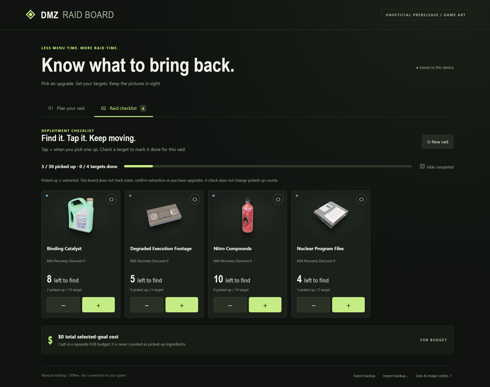

# DMZ Raid Board

An offline Windows raid planner and manual checklist built with TypeScript, HTML/CSS and Electron. Choose goals, aggregate shared ingredients, edit raid targets, and track picked-up counts using a simple picture-first layout.

This is an unofficial community prototype, not affiliated with Activision. The repository contains original application source and a preview of the app. The artwork-inclusive prerelease bundles third-party game images; the individual image collection and private runtime data are not committed to the source tree. Game artwork and screenshots containing it are excluded from the MIT code license. Attribution does not establish permission or endorsement; see [third-party artwork notices](THIRD-PARTY-ARTWORK.md).

## Windows portable build

The artwork-inclusive prerelease contains third-party game imagery attributed to Activision/respective rights holders and sourced via DMZ Codex, plus an owner-provided gameplay screenshot. No affirmative reuse or redistribution license was established, and the app grants no downstream artwork rights. An artwork-free build remains available from source with `npm run package:public`. Extract the entire Windows x64 artwork-inclusive ZIP into a writable folder and run DMZ Raid Board.exe. Keep its accompanying files. The build is unsigned; no installation is required. Data is stored in the data folder beside the executable. Export/import a backup to move a board between folders.

## Artwork-inclusive app preview



Captured from the actual artwork-inclusive Windows artifact using a separate test profile. Counts are synthetic examples, not owner inventory. No desktop, account details, local paths or private runtime data are shown. Game artwork in this preview is third-party material; the notice above applies.

## Run from source

Use Node 24 or a compatible maintained Node release. The pinned development dependencies are Electron 45.0.0, TypeScript 7.0.2, electron-builder 26.18.0 and Playwright 1.64.1.

```sh
npm ci
npm start
```

The app works with labeled placeholders when artwork is absent. See [optional artwork setup](assets/README.md). It does not fetch art, fonts, scripts or game data at runtime.

## Features

- Ten printer category views, recipe search and shared-ingredient totals.
- Repeatable craft quantities and fixed permanent upgrade tiers.
- Editable raid targets separate from recipe totals and picked-up counts.
- Raid +/- controls, completion checks, hide completed and confirmed new-raid reset.
- Local persistence, validated versioned JSON backups and corrupt-data recovery.
- A sandboxed renderer with context isolation, no Node/IPC bridge and blocked remote content.

Picking up is not extracting. The app does not track stash or actual extracted loot, infer unlocked recipes, purchase upgrades, or connect to game processes.

## Catalog status

The catalog includes all 95 crafting recipes in the two compared public references, plus 25 explicitly reported upgrade tiers: 120 entries, 112 selectable and eight disabled for concrete cost conflicts or missing cash requirements. All ten categories have working recipes, including 14 ingredient-printing recipes. This covers the compared published lists, not a claim that every current/future in-game tier is known. See [catalog evidence](CATALOG.md).

Ingredients sort A–Z in planning, raid cards and selectors. Printing is explicit: selected ingredient crafts offset their matching required output once; no other recipe expands automatically and no unlock/production is credited. Print only with recipes/upgrades already unlocked in your game. Direct manual targets still override computed totals.

## Checks and packaging

```sh
npm test
npm run test:ui
npm run package:public
```

The UI test drives a real Electron process and uses an isolated local profile. The public packaging command clears prior copied artwork and builds an unsigned Windows x64 ZIP with no game art. `npm run package` separately builds a private-art candidate; do not publish that private artifact. It does not install the app or publish a release. Packaged builds keep data beside the executable in a `data` folder, so extract into a writable folder and retain the accompanying files.

## License

MIT for original application code. Game names, trademarks, artwork and other third-party materials remain their owners' property and are outside that license. The app code license does not grant any reuse or redistribution rights to third-party game artwork, including artwork shown in documentation previews.

MIA Recovery Discount II is owner-verified on 2026-10-25 with four material requirements and zero cash. Its tier effect is a 5% recovery cost reduction. See the catalog for provenance and unresolved tiers.
