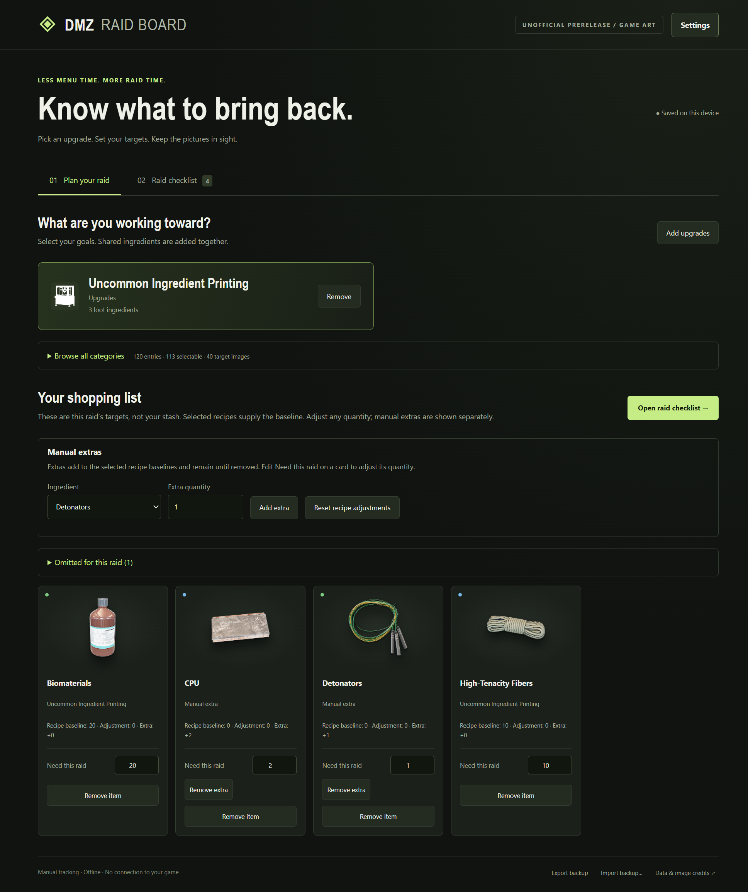

# DMZ Raid Board

An offline standalone desktop raid planner and manual checklist built with TypeScript, HTML/CSS and Electron. Choose goals, aggregate shared ingredients, edit raid targets, and track picked-up counts using a simple picture-first layout. Planning and raid views show items to loot; monetary amounts are omitted. Settings displays the actual packaged app version.

This is an unofficial community prototype, not affiliated with Activision. The repository contains original application source and a preview of the app. The artwork-inclusive prerelease bundles third-party game images; the individual image collection and private runtime data are not committed to the source tree. Game artwork and screenshots containing it are excluded from the MIT code license. Attribution does not establish permission or endorsement; see [third-party artwork notices](THIRD-PARTY-ARTWORK.md).

## Desktop downloads

The artwork-inclusive prerelease contains third-party game imagery attributed to Activision/respective rights holders and sourced via DMZ Codex, plus an owner-provided gameplay screenshot. No affirmative reuse or redistribution license was established, and the app grants no downstream artwork rights. An artwork-free build remains available from source with `npm run package:public`. Extract the entire Windows x64 artwork-inclusive ZIP into a writable folder and run DMZ Raid Board.exe. Keep its accompanying files. The build is unsigned; no installation is required. Data is stored in the data folder beside the executable. Export/import a backup to move a board between folders.

The desktop builds target Windows x64 portable ZIP, macOS Apple Silicon app ZIP/DMG, and Linux x64 AppImage. The app runs as a desktop application; an external browser is not required. No Intel Mac package is produced for this version.

macOS builds are ad-hoc signed, without Developer ID signing or notarization. Native automated launch checks do not establish Gatekeeper acceptance on every Mac. Linux automated launch uses AppImage extract-and-run under Xvfb; FUSE mounting and desktop/distribution acceptance are separate checks. No system security changes or bypass instructions are included.

## Artwork-inclusive app preview



Captured from the actual artwork-inclusive Windows artifact using a separate test profile. Counts are synthetic examples, not owner inventory. No desktop, account details, local paths or private runtime data are shown. Game artwork in this preview is third-party material; the notice above applies.

## Run from source

Use Node 24 or a compatible maintained Node release. The pinned development dependencies are Electron 45.0.0, TypeScript 7.0.2, electron-builder 26.18.0 and Playwright 1.64.1.

```sh
npm ci
npm start
```

The app works with labeled placeholders when artwork is absent. See [optional artwork setup](assets/README.md). It does not fetch art, fonts, scripts or game data at runtime.

## Features

- Ten printer category views, recipe search and shared-ingredient totals.
- Repeatable craft quantities and fixed permanent upgrade tiers.
- Automatic recipe baselines, signed adjustments and explicit manual extras, separate from picked-up counts.
- Raid +/- controls, completion checks, hide completed and confirmed new-raid reset.
- Local persistence, validated versioned JSON backups and corrupt-data recovery.
- A sandboxed renderer with context isolation, no Node/IPC bridge and blocked remote content.

Picking up is not extracting. The app does not track stash or actual extracted loot, infer unlocked recipes, purchase upgrades, or connect to game processes.

## Catalog status

The catalog includes all 95 crafting recipes in the two compared public references, plus 25 explicitly reported upgrade tiers: 120 entries, 113 selectable and seven disabled for unresolved requirements. All ten categories have working recipes, including 14 ingredient-printing recipes. This covers the compared published lists, not a claim that every current/future in-game tier is known. See [catalog evidence](CATALOG.md).

Ingredients sort A–Z in planning, raid cards and selectors. Printing is explicit: selected ingredient crafts offset their matching required output once; no other recipe expands automatically and no unlock/production is credited. Print only with recipes/upgrades already unlocked in your game. Manual extras add to the plan; edits to recipe items are signed adjustments that follow their baseline.

## Checks and packaging

```sh
npm test
npm run test:ui
npm run package:public
```

The UI test drives a real Electron process and uses an isolated local profile. The public packaging command clears prior copied artwork and builds an unsigned Windows x64 ZIP with no game art. `npm run package` separately builds a private-art candidate; do not publish that private artifact. It does not install the app or publish a release. Windows packaged builds keep data beside the executable in a `data` folder, so extract into a writable folder and retain the accompanying files. macOS and Linux use Electron’s writable per-user application-data location, outside the app bundle or AppImage mount.

## License

MIT for original application code. Game names, trademarks, artwork and other third-party materials remain their owners' property and are outside that license. The app code license does not grant any reuse or redistribution rights to third-party game artwork, including artwork shown in documentation previews.

MIA Recovery Discount II retains its owner-verified four material requirements from 2026-10-25. See the catalog for provenance and unresolved tiers. Removing monetary UI does not alter the source evidence or silently enable unresolved entries.

## Settings and themes

Use the visible Settings button at the top right for the app version, Export backup, Import backup and Theme. Original Raid Board remains the default. The other 26 choices adapt the confirmed DLMS collection, including Omarchy, with retained MIT notices; see THEMES.md. Layout and item artwork remain unchanged.

Version 0.1.6 imports older version-1 backups and exports version 2 with separate adjustments/extras. Legacy zero overrides are dropped with a visible migration notice; the original board/import is retained. Keep an old backup for older app versions. Theme preference is saved separately. When moving to a new portable folder, export from the older app, extract the entire candidate into a new writable folder, open Settings in the candidate and import the JSON. Selections, raid targets, picked-up counts and checks transfer; choose your theme again once in the new folder. Keep the older app and its data until the import is verified. Prior releases and their data remain unchanged. Version 0.1.6 uses a new storage key and retains the previous board for rollback; see the documented migration rules.

See [native packaging notes](PLATFORM-CANDIDATES.md) for automated checks, per-user storage and signing limitations. The application icon is a separate owner-requested DMZ adaptation of the DLMS badge; see [icon provenance](branding/README.md). All previous release tags and binaries are preserved.


## 0.1.7 goal summary and artwork

The goal summary contains selected goals only, with explicit Remove and Add upgrades controls. Manual extras stay visible. Omitted targets have a separate counted disclosure, collapsed by default. Version-2 board and backup semantics are unchanged. Military Composites now uses an unchanged owner screenshot with an icon-only CSS crop; surrounding recipe text and owned counts are excluded from display. See docs/local-0.1.7.md. The desktop prerelease targets Windows x64, Apple Silicon macOS and Linux x86_64. Back up before moving to a new portable folder.
